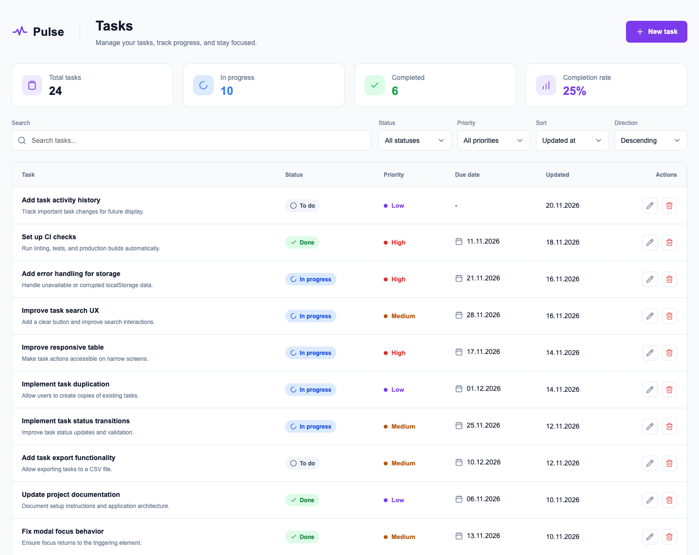
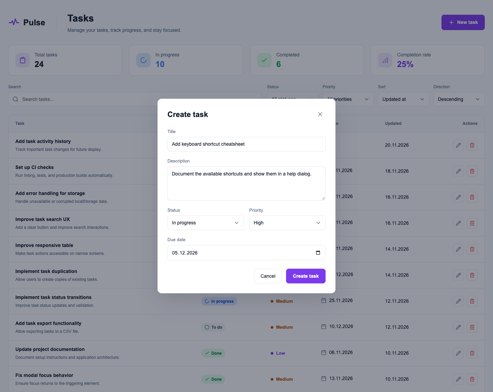

# Pulse

**[▶ Live demo — pulse-taskboard.vercel.app](https://pulse-taskboard.vercel.app/)**

Pulse is a task management dashboard built with Angular 22. It is a portfolio project
focused on modern Angular patterns: standalone components, signal-based state, a zoneless
application (no `zone.js`), and a feature-first project structure.

All data lives in the browser — tasks are persisted to `localStorage`, and a demo dataset
is seeded on first launch, so the app is fully usable without a backend.

## Screenshots

Captured from the live deployment at
[pulse-taskboard.vercel.app](https://pulse-taskboard.vercel.app/).

### Dashboard

Statistics, search, filters and the task table, seeded with the demo dataset.



### Create task dialog

The reactive form behind "New task", rendered in a native modal `<dialog>`.



## Features

- **Task CRUD** — create, edit and delete tasks. Each task has a title, description,
  status (`To do` / `In progress` / `Done`), priority (`Low` / `Medium` / `High`) and an
  optional due date.
- **Statistics** — live cards for total tasks, tasks in progress, completed tasks and the
  completion rate, all derived from the task list.
- **Search** — case-insensitive matching across task titles and descriptions.
- **Filtering** — by status and by priority, with a "Clear filters" action that appears
  only while filters are active.
- **Sorting** — by updated date, title, status, priority or due date, ascending or
  descending. Tasks without a due date are always sorted last.
- **Reactive form validation** — the title is required and whitespace-only input is
  rejected by a custom `trimmedRequired` validator; submitting an invalid form marks the
  fields as touched and shows an inline error instead of saving.
- **Accessible dialogs** — the task and confirmation dialogs use the native `<dialog>`
  element with `showModal()`, so `Esc` and the backdrop behave as expected. Opening the
  task dialog moves focus to the first field; the delete dialog focuses the non-destructive
  action.
- **Delete confirmation** — destructive deletes go through a confirmation dialog naming the
  task.
- **Distinct empty states** — a first-run state ("no tasks yet") and a filtered state
  ("no tasks match your filters").
- **Persistence** — the task list is written to `localStorage` on every change and
  validated when read back.
- **Responsive, themeable UI** — SCSS with CSS custom properties for colors and radii, and
  tree-shaken Lucide icons.

## Tech stack

| Area | Choice |
| --- | --- |
| Framework | Angular 22.2 (standalone components, signals, zoneless) |
| Language | TypeScript 6.0 |
| Forms | Angular Reactive Forms |
| Styling | SCSS + CSS custom properties |
| Icons | `@ng-icons/core` + `@ng-icons/lucide` |
| Build | `@angular/build` (esbuild-based application builder) |
| Tests | Vitest via the Angular CLI `unit-test` builder |
| Tooling | ESLint (`angular-eslint`, `typescript-eslint`), Prettier |

## Getting started

Requirements: Node.js **22.22.3+**, 24.15.0+ or 26.0.0+ — the minimum versions the
Angular 22 CLI enforces — and npm 10+. These are pinned in `engines`, and `.nvmrc`
holds the exact version used for development, so `nvm use` picks it up:

```bash
# use the project's Node version
nvm use

# install dependencies
npm install

# start the development server on http://localhost:4200
npm start
```

Other scripts (all defined in `package.json`):

```bash
npm test            # run unit tests with Vitest
npm run lint        # lint TypeScript and templates
npm run format      # format src/** with Prettier
npm run format:check # verify formatting without writing
npm run watch       # rebuild on change using the development configuration
npm run build       # production build
```

## Architecture

```
src/app/
├── app.ts, app.config.ts, app.routes.ts   # root component and application providers
├── icons.ts                               # every Lucide icon, registered once at the root
├── tasks/
│   ├── task-store.ts                      # signal-based state: tasks + query + derived state
│   └── task-storage.ts                    # localStorage read/write with runtime validation
├── features/tasks/
│   ├── data/
│   │   ├── task.model.ts                  # Task, TaskDraft, TaskQuery, TaskStats types
│   │   ├── task.query.ts                  # pure filter / sort / stats functions
│   │   ├── task-date.utils.ts             # local-date helpers (today, overdue)
│   │   └── demo-tasks.ts                  # first-launch demo dataset
│   ├── pages/task-workspace/              # smart component: wires the store to the UI
│   ├── ui/                                # presentational components
│   │   ├── task-list/                     # task table with edit / delete actions
│   │   ├── task-filters/                  # search, status, priority, sort controls
│   │   ├── task-form/                     # reactive form for create and edit
│   │   └── task-dialog/                   # modal wrapper around the form
│   └── validators/                        # trimmed-required title validator
└── shared/ui/confirm-dialog/              # reusable confirmation dialog
```

**Layering.** `data/` holds types and pure functions with no Angular dependencies, which
makes filtering, sorting and statistics trivially testable. `TaskStore` is the only piece
of mutable state. `TaskWorkspace` is the single smart component: it reads the store and
owns dialog state. Everything under `ui/` is presentational — data in through `input()`,
intent out through `output()` — so the components can be reasoned about and tested in
isolation.

**State management with signals.** `TaskStore` is a `@Service()`-provided singleton that
keeps two writable signals — the task list and the active query — and exposes them as
readonly:

```ts
private readonly _tasks = signal<Task[]>(/* stored tasks or demo data */);
readonly tasks = this._tasks.asReadonly();

readonly stats = computed(() => computeStats(this._tasks(), getTodayISO()));
readonly visibleTasks = computed(() => applyTaskQuery(this._tasks(), this._taskQuery()));
readonly hasActiveFilters = computed(() => /* ... */);
```

Everything the UI renders — visible tasks, statistics, whether filters are active — is a
`computed()` over those two signals, so there is no state to synchronize and no manual
change detection. Mutations go through intent-named methods (`addTask`, `updateTask`,
`deleteTask`, `setSearch`, `setStatus`, `setPriority`, `setSort`, `resetFilters`) that
replace signal values immutably.

The app is zoneless: `zone.js` is not a dependency, and signals alone drive change
detection. Components use the modern signal APIs throughout — `input()`, `output()`,
`viewChild()`, `signal()`, `computed()` and `effect()` — with the built-in template
control flow (`@if`, `@for`, `@switch`).

## Demo data and persistence

Tasks are persisted to `localStorage` under the key **`pulse.tasks`**:

- **Writing.** An `effect()` in `TaskStore` serializes the task list on every change, so
  persistence is a side effect of state rather than something each action has to remember.
- **Reading.** `TaskStorage.loadTasks()` parses the stored value and type-checks every
  entry (`id`, `title`, `description`, `status`, `priority`, `dueDate`, `createdAt`,
  `updatedAt`). Malformed or non-parsable data falls back to an empty list instead of
  crashing the app.
- **Demo seeding.** `hasStoredTasks()` checks whether the key exists at all, which
  distinguishes a first launch from a list the user deliberately emptied. On a first launch
  only, 24 demo tasks are generated with `crypto.randomUUID()` ids and staggered
  `createdAt` / `updatedAt` timestamps relative to the current date; afterwards the stored
  data always wins.

To get the demo dataset back, clear the key and reload:

```js
localStorage.removeItem('pulse.tasks');
```

## Production build

```bash
npm run build
```

The production configuration is the default build target. Output is written to
`dist/pulse/browser/` with content hashing enabled and bundle budgets enforced
(500 kB initial warning / 1 MB error). The result is a static bundle that can be served by
any static host or web server:

```bash
npx http-server dist/pulse/browser
```

A development build (unoptimized, with source maps) is available via:

```bash
npm run watch
```

## Testing

Unit tests run on Vitest through the Angular CLI:

```bash
npm test
```

The suite covers `TaskStore` (initial state, demo seeding, mutations, derived state,
immutability) and the pure data layer (search / status / priority filtering, statistics,
date helpers), plus component creation smoke tests.
